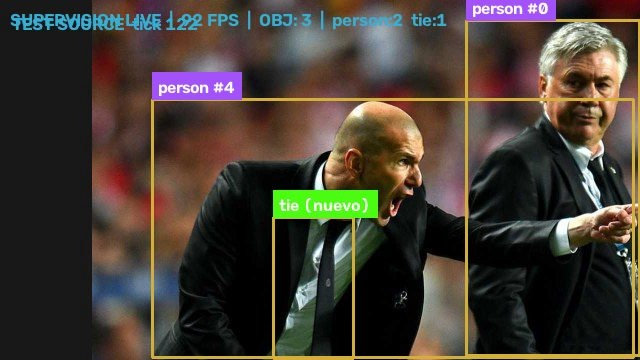

# Supervision Live

**Detección y tracking de objetos en tiempo real sobre vídeo en directo — con un harness que se verifica solo.**

Un reclutador o un colega clona el repo, mete dos comandos y ve pasar frames anotados. Sin móvil, sin GPU, sin nube, sin credenciales. Y `./init.sh` no dice "ok" por cortesía: comprueba dependencias, sintaxis, tests y que el pipeline sirva frames de verdad — si algo falla, **exit 1**.

```bash
git clone https://github.com/ivanintech/supervision-live && cd supervision-live
uv venv --python 3.12 .venv && uv pip install --python .venv/bin/python -r requirements.txt
./init.sh
```

```
=== 1/4 entorno ===    deps OK
=== 2/4 sintaxis ===   sintaxis OK
=== 3/4 tests ===      3 passed
=== 4/4 pipeline ===   stats: {"fps": 113.5, "detections": 5, "counts": {"bus": 1, "person": 4}, "source_ok": true}
PIPELINE OK
```



Captura real del pipeline: cajas de YOLO11 con el ID que asigna ByteTrack a cada objeto
(`person #4`, `person #0`) y detecciones aún sin confirmar marcadas `(nuevo)`.

## Cómo está montado

```
cámara IP (MJPEG)  →  YOLO11 (ultralytics)  →  ByteTrack (trackers)  →  /video anotado
                                                                     →  /stats JSON
```

| Pieza | Qué hace |
|---|---|
| `live_cam.py` | Ingesta MJPEG, inferencia, tracking, anotación y servidor HTTP. Reconexión automática. |
| `test_source.py` | Generador MJPEG de prueba: anima imágenes reales desplazándose, para validar el pipeline sin cámara. |
| `tests/test_pipeline.py` | Tests de detección, estabilidad de IDs y de la etiqueta de anotación. Corren sin red. |
| `init.sh` | Verificación completa. `./init.sh` arranca, `./init.sh stop` para. |
| `feature_list.json` | Estado de cada feature con la **evidencia** que lo respalda. |
| `PROGRESS.md` | Bitácora de sesión y decisiones con su motivo. |
| `AGENTS.md` | Contexto para agentes: cómo arrancar, qué está verificado, qué no tocar. |

## Uso con la cámara del móvil

Necesitas la app **IP Webcam** (Play Store, gratis) sirviendo en `http://<IP-móvil>:8080/video`.

```bash
# 1. En el móvil: abre IP Webcam → botón rojo "Iniciar servidor"
# 2. En el PC:
.venv/bin/python live_cam.py --source http://192.168.1.15:8080/video --port 8090 --conf 0.35
```

Luego abre `http://localhost:8090/video` en el navegador.

| Flag | Defecto | Qué hace |
|------|---------|----------|
| `--source` | `http://192.168.1.15:8080/video` | Fuente MJPEG/RTSP |
| `--model` | `yolo11n.pt` | Modelo (CPU-friendly; `yolo11s.pt` si sobra) |
| `--conf` | `0.35` | Umbral de confianza |
| `--classes` | todas | IDs COCO separados por coma: `0`=person, `2`=car, `5`=bus |
| `--port` | `8090` | Puerto del stream local |
| `--width` | `640` | Ancho de procesado (menor = más FPS en CPU) |
| `--rotate` | `0` | `90`/`180`/`270` — IP Webcam entrega el sensor en landscape |
| `--flip` | `none` | `h`/`v`/`both` — cámara frontal sale invertida → `h` |

## Endpoints

- `/video` → MJPEG anotado (cajas + ID de tracking + HUD de FPS y conteos)
- `/stats` → `{fps, detections, counts, source_ok, error}`
- `/health` → estado de la fuente

## Detalles que costaron encontrar

- **`sv.ByteTrack` ya no existe.** A partir de supervision 0.31 el tracker vive en el paquete `trackers` y el método cambió a `ByteTrackTracker.update(detections)`. Con la API antigua el pipeline no arrancaba.
- **`tracker_id == -1` significa "sin confirmar"**, no un ID válido. Pintarlo tal cual producía etiquetas `person #-1`; ahora se marcan `(nuevo)`. Hay un test de regresión.
- **Los pesos no se versionan.** `yolo11n.pt` (5,4 MB) lo descarga ultralytics en el primer arranque; verificado en clon limpio.
- **CPU por defecto.** Con `yolo11n` a 640 px: entre 60 y 150 FPS según carga (el generador de prueba es más rápido que una cámara real).

## Requisitos

- Python **3.12**
- Linux o macOS (probado en CachyOS). Windows no probado.

Versiones exactas en `requirements.txt`; volcado completo de transitivas en `requirements.lock`.
